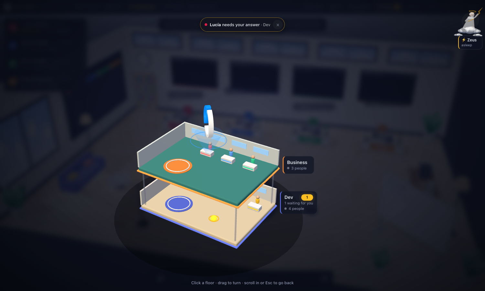
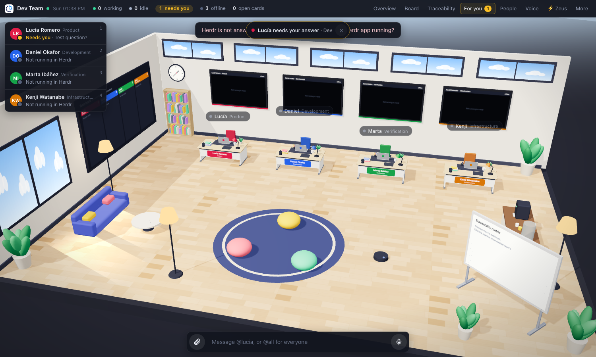
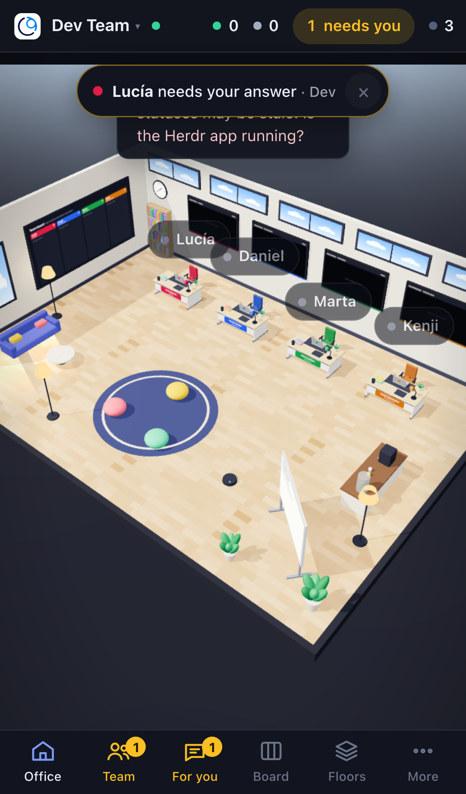

# Agent Office

Run teams of coding agents like a small company, and watch them work in a 3D office you can open from your phone.

Each floor is a team. Each desk is an agent (Claude Code or Codex) running in a [Herdr](https://herdr.dev) terminal
with a role, a shared protocol and a memory file. You talk to any of them from the office: chat, voice, images,
answers to the questions they ask you.

| Dev floor | On the phone |
|---|---|
|  |  |

## What you get

- **A Dev floor** (port 4317): Lucía (product lead), Daniel (development), Marta (verification), Kenji
  (infrastructure). They plan, build, review and verify work through cards, with strict guardrails: no merge,
  deploy or production change without you.
- **A Business floor** (port 4318): Irene (coordinator, triages your inbox), Pablo (clients), Elena (partners and
  proposals). They prepare drafts in your voice and never send anything.
- **Zeus**, a superadmin agent above the building who changes the office system itself when you ask: new floors,
  new people, how things look and work.
- **Chat with every agent**, with markdown, tables, links to PRs and tickets, image attachments and dictation.
- **Requests**: agents ask you questions with options; you answer from the office, the phone or the Herdr panel.
- **A board** fed by Jira (optional) and local cards, pull requests waiting for you, and a traceability matrix.
- **Local artifacts**: agents publish pages (HTML, Markdown, MDX) on a local server and link them in chat.
- **Herdr panels**: Requests, Drafts, PRs, Board, Trace and usage limits, in a ready layout.
- **Phone access** over Tailscale, with notifications, installable on the home screen. Nothing is exposed to the internet.
- **Voice** (optional): a local transcriber on your Mac; no audio leaves the machine.

## Install

You do not install this by hand. Clone the repo, open it with your coding agent and say:

> Set up the agent office from this repo.

The agent follows [`setup/SETUP.md`](setup/SETUP.md): it checks your Mac, asks you the decisions (your name and
language, Claude Code or Codex or both, Jira or not, phone access, voice, a second machine), installs what is
missing with your go-ahead, and verifies each step.

Requirements: a Mac (Apple Silicon recommended), a Claude or ChatGPT subscription for the agent CLI you choose, and
about 15 minutes. Everything else is installed during setup.

## Update

`git pull`, then ask your agent to "update the agent office", or run:

    python3 setup/install.py --config ~/.omniloy-office/install.json

Apps, tools, panels and skills are replaced. Your team folders (people, protocols, memory, requests) are never
overwritten; when the repo has a newer protocol it is left next to yours as `PROTOCOL.md.new`.

## What is where

| In the repo | Installed to | What |
|---|---|---|
| `offices/team-office`, `offices/biz-office` | `~/.omniloy-office/` | The office web apps (Node, no build step) |
| `services/artifacts` | `~/.omniloy-office/artifacts` | Local pages server (port 4340) |
| `bin/` | `~/.local/bin/` | `team-ask`, `team-card`, `team-person`, `omniloy-team`, `office-restart` and friends |
| `teams/dev`, `teams/biz`, `teams/admin` | `~/.omniloy-team`, `~/.omniloy-biz`, `~/.omniloy-admin` | Team definition, protocol, memory |
| `teams/*/agents` | `~/.claude/agents/` | Each person's instructions |
| `skills/` | `~/.claude/skills`, `~/.codex/skills` | Skills every agent gets |
| `herdr/` | `~/.config/herdr-app/` | Panels and layout for the Herdr app |
| `setup/` | not installed | The installer, its health check and the guide for the installing agent |

Files in the repo contain the placeholders `__OWNER__`, `__OWNER_ID__` and `__LANGUAGE__`; the installer fills
them in. After the install, ask Zeus (More > Zeus in the office) for any change: he has a handbook of the system.

## Safety

- The servers listen on 127.0.0.1 only. The phone comes in through Tailscale, and only the Tailscale logins you
  list in `~/.omniloy-team/remote.json` are let in.
- Agents never merge, deploy, change production, or send messages in your name. The business floor makes drafts.
- Tokens live in the macOS Keychain or in each tool's own sign-in; they are not in this repo or in any file it writes.
